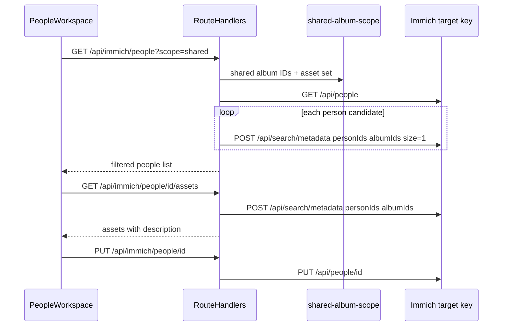

# DES-005: People catalogue and RHS asset panel

**Traces to:** UC-014, UC-008, [floorplan](./user-interface/floorplan.md)  
**Status:** Accepted

## Goals

- **People** route replaces stub: shared-album-scoped person catalogue with inline identity fields.
- RHS panel: per-person asset grid (thumbnail + description); double-click handoff to Explore.
- All Immich calls as **target** ([ADR-0001](../adr/0001-server-side-immich-api.md)).

## Non-goals (v1)

- Face merge/split, reassign faces, hidden-people toggle.
- Separate first/last name (Immich single `name` only).
- Per-album People filter (union of all operator-shared albums).

## Layout

| Region | Content |
|--------|---------|
| Main canvas | Person tiles using shared **PersonIdentityEditor** (face thumb, name, DOB `dd/mm/yyyy` + calendar icon) |
| RHS panel | Asset grid (single-click select); below grid: **face wheel** or sole **PersonIdentityEditor**; double-click asset → Explore |

Interaction matches Albums/Explore: selection opens panel; Esc/backdrop closes panel per shell.

## Server / data flow

### Scope filter (v1)

1. `getSharedAlbumIds(operatorUserId)` from target album list ([UC-009](./../use-cases/UC-009-album-crud-in-curator.md) share semantics).
2. For each person from paginated `GET /api/people` (skip `isHidden`), include if `POST /api/search/metadata` with `{ personIds: [id], albumIds: sharedIds, size: 1 }` returns `assets.total > 0`.
3. Person assets for panel: same search with larger page size (500 cap per album scope; paginate if needed later).

### Thumbnails

- Person face: `GET /api/immich/people/{id}/thumbnail` → proxy Immich person thumbnail.
- Assets: existing asset thumbnail proxy.

### Explore handoff

- Navigate to `/explore?assetId={id}&albumId={resolved}`.
- `resolveExploreForAsset` picks shared album containing asset (prefer default album when valid).

## Face wheel (panel, selected photo)

After **single-click** on an asset, `GET /api/immich/assets/{id}` supplies `people[]`.

| Case | UI |
|------|-----|
| One face (or only context person) | `PersonIdentityEditor` only |
| Context + other faces | SVG **FaceWheelSvg**: context at hub; other faces on rotatable spokes with top focus gap; scroll wheel rotates; click snaps spoke to top; editor below tracks top spoke after engage |

- **Double-click** spoke → change main catalogue selection (`onSwitchContextPerson`).
- Layout math: [`face-wheel-layout.ts`](../../src/lib/people/face-wheel-layout.ts).

## Client components

| Component | Role |
|-----------|------|
| `people-workspace.tsx` | Shell, selection, save state |
| `person-identity-editor.tsx` | Shared name/DOB Save (catalog + panel) |
| `person-catalog-grid.tsx` | Catalogue tiles |
| `person-context-panel.tsx` | Panel + asset selection |
| `person-asset-grid.tsx` | Single-click select; double-click → Explore |
| `asset-faces-section.tsx` | Fetch asset people; wheel vs sole editor |
| `face-wheel-svg.tsx` | Hub-and-spoke SVG widget |

## Open questions

- Catalogue size > ~50 persons: batch or cache scope filter (acceptable for Poundsgate v1).
