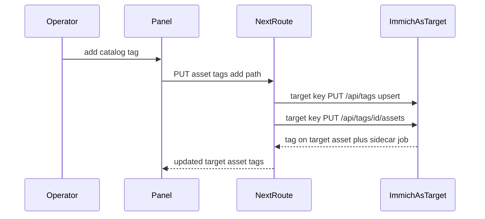

# DES-007: Tag editor (target writes)

**Traces to:** [UC-005](../use-cases/UC-005-ian-assign-tags-to-asset.md), [US-001](../user-stories/US-001-geoff-knows-ian-catalogs.md), [ADR-0001](../adr/0001-server-side-immich-api.md), [ADR-0002](../adr/0002-curator-operator-and-target.md), [floorplan](./user-interface/floorplan.md)  
**Supersedes:** the tag-editor non-goal in [DES-004](./DES-004-asset-curation-panel.md) (that note stays as the v1 panel boundary).  
**Status:** Accepted  
**Installation reference:** [`/home/ian/immich/docs/tags.md`](/home/ian/immich/docs/tags.md)

## Goals

- The operator edits tags in the RHS **AssetCurationPanel** (Explore and in-album explore).
- Every Immich tag call uses the **target** key: `immichJson` / `immichFetchTarget`. Tags are created in the target’s tree and attached to the target’s asset.
- Chips show full `value`. Provenance prefixes cannot be removed from the curator.
- Create and attach in one step so TagCleanup does not drop an unused tag.

## Non-goals (v1)

- Tag colours, rename, or delete of a tag record.
- A Tags item in the left nav.
- Suggesting tags from the description.
- Server-side `filter.tagIds` / `filter.hasTags` on the grid ([UC-015](../use-cases/UC-015-filter-sort-group-asset-grids.md) follow-up).
- `immichFetchOperator` / `immichJsonOperator` on any tag route. That key stays on album activity comments ([DES-004](./DES-004-asset-curation-panel.md)).

## User interface

Replace the read-only tag line in the panel with a **Tags** section.

| Control | Behaviour |
|---------|-----------|
| Provenance chips | `value` starts with `import/` or `{immich-go}/`. Shown in full. No remove control. |
| Catalog chips | Any other `value`. Remove calls detach for that asset. |
| Combobox | Lists the target’s tags from `GET /api/tags`, filtered by the typed string (match on `value`). Choosing a row attaches that id. |
| Enter on a new string | Upserts the path on the target (`PUT /api/tags` `{ tags: [path] }`), then attaches the leaf. `/` creates missing parents. A `value` that already exists attaches the existing id. |
| Errors | Inline text in the section. No `alert` / `confirm` ([ADR-0003](../adr/0003-tech-stack-and-engineering-practices.md)). |

After a successful attach or detach, refetch the asset and render `tags` from that response.

The browser never receives either API key ([ADR-0001](../adr/0001-server-side-immich-api.md)).

### v2 (same panel, later phase)

When several assets are selected, the panel offers **add one catalog tag** to all of them (`PUT /api/tags/assets` as the target). No bulk detach of provenance tags.

## Server / data flow

Proxies under `src/app/api/immich/`. Handlers call `immichJson` / `immichFetchTarget` only, same actor as [`assets/[assetId]/route.ts`](../../src/app/api/immich/assets/[assetId]/route.ts).

| Curator route | Immich | Body |
|---------------|--------|------|
| `GET /api/immich/tags` | `GET /api/tags` | — |
| `PUT /api/immich/tags` | `PUT /api/tags` | `{ tags: string[] }` |
| `PUT /api/immich/assets/[assetId]/tags` | upsert if needed, then `PUT /api/tags/:id/assets` | `{ tagId }` or `{ value }` |
| `DELETE /api/immich/assets/[assetId]/tags` | `DELETE /api/tags/:id/assets` | `{ tagId }` or `{ value }` |

`DELETE` rejects `value` (or the loaded tag’s `value`) that starts with `import/` or `{immich-go}/`, even if the client omits the lock. Response is an inline-able 400.

Extend `ImmichTag` with `value`, `parentId`, and optional `color`. Grid fields that print a tag name use `value` ([`grid-field-value.ts`](../../src/lib/assets/grid-field-value.ts)).

Duplicate `value` for the target user is success: resolve the existing tag and attach it.

## Open questions

- None for v1. Bulk attach is specified above and sequenced in the implementation plan, not in the first build.
