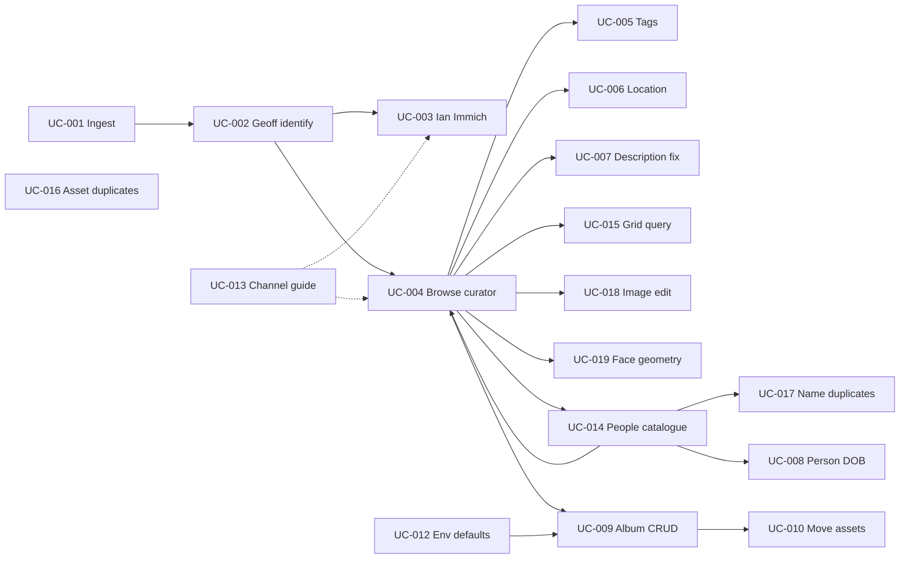

# Use cases

Structured behaviour derived from [user stories](../user-stories/). One file per `UC-NNN`.

## Template

```markdown
# UC-NNN: Title

**Primary actor:** …  
**Supporting actors:** …  
**Channel:** Immich UI | immich-curator | dartmoor ops  
**Preconditions:** …  

## Main flow
1. …

## Alternate flows
- …

## Postconditions
- …

**Traces to:** US-NNN  
**Informs:** DES-NNN, ADR-NNNN
```

## Index

Covers [US-001](../user-stories/US-001-geoff-knows-ian-catalogs.md) through [US-005](../user-stories/US-005-edit-image-in-preview-modal.md) and [US-002](../user-stories/US-002-split-albums-shared-with-ian.md).

**Sign-off grid:** [STATUS.md](./STATUS.md) (Curator / Ops / Immich / Verified).

| ID | Title | Channel | Status |
|----|-------|---------|--------|
| [UC-001](./UC-001-ingest-scanned-photos-poundsgate.md) | Ingest scanned photos into Geoff’s Poundsgate corpus | dartmoor ops | Draft |
| [UC-002](./UC-002-geoff-edit-description-and-name-faces.md) | Geoff edit description and name faces | Immich (Geoff) | Draft |
| [UC-003](./UC-003-ian-curate-in-shared-album-immich.md) | Operator curate shared album (panel + preview modal) | Immich + immich-curator | Signed off (2026-11-03); extended v2 |
| [UC-011](./UC-011-remove-from-album-park-unidentifiable.md) | Remove from album / park unidentifiable | immich-curator | Draft |
| [UC-004](./UC-004-browse-album-assets-in-curator.md) | Browse album assets in immich-curator | immich-curator | Draft → partial (preview modal) |
| [UC-005](./UC-005-ian-assign-tags-to-asset.md) | Operator assign tags to a target asset (as the target) | immich-curator | Complete (v1) |
| [UC-006](./UC-006-ian-set-asset-map-location.md) | Ian set map location | immich-curator | Draft |
| [UC-007](./UC-007-ian-correct-asset-description.md) | Ian correct asset description | immich-curator | Partial (panel + modal) |
| [UC-008](./UC-008-ian-correct-person-date-of-birth.md) | Ian correct person DOB | immich-curator | Draft |
| [UC-009](./UC-009-album-crud-in-curator.md) | Album CRUD: list all G albums, create, share with Ian, update/delete | immich-curator (Albums) | Complete (v1: read, share/unshare, in-album explore) |
| [UC-010](./UC-010-move-assets-between-albums.md) | Move assets between albums | immich-curator | Draft |
| [UC-012](./UC-012-configure-curator-identity.md) | Configure curator operator & target (env + Admin) | env + Admin | Signed off (2026-11-03) |
| [UC-013](./UC-013-select-curation-channel.md) | Select Immich vs curator channel | reference | Draft |
| [UC-014](./UC-014-browse-people-in-shared-albums.md) | Browse/edit people in shared albums | immich-curator (People) | Complete (v2: index, 3 tabs, lazy faces) |
| [UC-015](./UC-015-filter-sort-group-asset-grids.md) | Filter, sort, group asset grids | immich-curator | Complete (v1); person scope variant |
| [UC-016](./UC-016-browse-and-delete-duplicates.md) | Delete Immich duplicate **assets** | immich-curator (`/duplicates`) | Complete (v1) |
| [UC-017](./UC-017-reconcile-similar-person-names.md) | Merge / reassign similar **person names** | immich-curator (People → Duplicates) | Complete (v1) |
| [UC-018](./UC-018-edit-image-in-preview-modal.md) | Edit raster image in full-screen preview | immich-curator (preview modal) | Complete (v1) |
| [UC-019](./UC-019-adjust-faces-in-preview.md) | Adjust face boxes and add faces in preview | immich-curator (preview modal) | Complete (v1) |

### Flow overview



### People vs asset “Duplicates”

| Nav / tab | UC | Meaning |
|-----------|-----|---------|
| Side nav **Duplicates** | UC-016 | Immich **pixel** duplicate groups |
| People tab **Duplicates** | UC-017 | **Person record** names that look alike |
