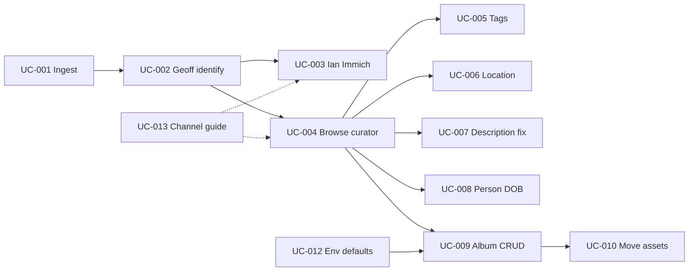

# Use cases

Structured behaviour derived from [user stories](../user-stories/). One file per `UC-NNN`.

## Template

```markdown
# UC-NNN: Title

**Primary actor:** …  
**Supporting actors:** …  
**Channel:** Immich UI | immich-curator | dartmoor ops  
**Preconditions:** …  

## Main flow
1. …

## Alternate flows
- …

## Postconditions
- …

**Traces to:** US-NNN  
**Informs:** DES-NNN, ADR-NNNN
```

## Index

Covers [US-001](../user-stories/US-001-geoff-knows-ian-catalogs.md) and [US-002](../user-stories/US-002-split-albums-shared-with-ian.md).

**Sign-off grid:** [STATUS.md](./STATUS.md) (Curator / Ops / Immich / Verified).

| ID | Title | Channel | Status |
|----|-------|---------|--------|
| [UC-001](./UC-001-ingest-scanned-photos-poundsgate.md) | Ingest scanned photos into Geoff’s Poundsgate corpus | dartmoor ops | Draft |
| [UC-002](./UC-002-geoff-edit-description-and-name-faces.md) | Geoff edit description and name faces | Immich (Geoff) | Draft |
| [UC-003](./UC-003-ian-curate-in-shared-album-immich.md) | Operator curate in shared album (invitee) | Immich (operator) | Draft |
| [UC-004](./UC-004-browse-album-assets-in-curator.md) | Browse album assets in immich-curator | immich-curator | Draft |
| [UC-005](./UC-005-ian-assign-tags-to-asset.md) | Ian assign tags from Geoff’s description | immich-curator | Draft |
| [UC-006](./UC-006-ian-set-asset-map-location.md) | Ian set map location | immich-curator | Draft |
| [UC-007](./UC-007-ian-correct-asset-description.md) | Ian correct asset description | immich-curator | Draft |
| [UC-008](./UC-008-ian-correct-person-date-of-birth.md) | Ian correct person DOB | immich-curator | Draft |
| [UC-009](./UC-009-album-crud-in-curator.md) | Album CRUD: list all G albums, create, share with Ian, update/delete | immich-curator (Albums) | Complete (v1: read, share/unshare, in-album explore) |
| [UC-010](./UC-010-move-assets-between-albums.md) | Move assets between albums | immich-curator | Draft |
| [UC-012](./UC-012-configure-curator-identity.md) | Configure curator operator & target (env + Admin) | env + Admin | Draft |
| [UC-013](./UC-013-select-curation-channel.md) | Select Immich vs curator channel | reference | Draft |

### Flow overview


